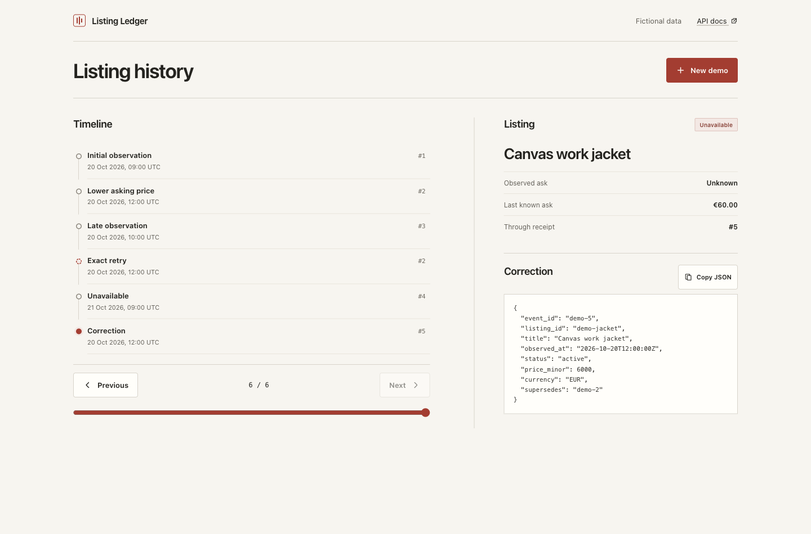

# Listing Ledger

[](https://github.com/dziugasmarcenas-ui/listing-ledger/actions/workflows/ci.yml)

Listing Ledger is a local demo of how duplicate, late, and corrected marketplace observations can be stored as an event history and replayed into listing state. It uses fictional data, a small FastAPI service, SQLite, and a buildless browser interface.



## Engineering decisions

- **Two clocks:** observation time determines listing state; receipt sequence determines what was known during a replay. A late event adds history without overwriting a newer observation.
- **Transactional retries:** a write transaction and unique event IDs make retry detection atomic, including concurrent delivery. An ID reused with different normalized content returns a conflict.
- **Corrections stay visible:** replay filters by receipt cutoff before resolving corrections. A later correction cannot leak into an earlier view.
- **One projection implementation:** the browser requests state from the API rather than maintaining a second version of the rules.

## Run it

Requirements: Python 3.13 or newer. From the project directory:

```sh
./scripts/dev.sh
```

The script creates `.venv` when needed, installs the pinned development dependencies and editable package, then serves the app at <http://127.0.0.1:8767>. Set `PORT` to use a different port. The default database is `./var/ledger.sqlite3`; set `LISTING_LEDGER_DB` to use another path. Stop the server with Ctrl+C. Run automated checks with `./scripts/check.sh`.

## Try the API

Create a synthetic replay in its own stream:

```sh
curl -sS -X POST http://127.0.0.1:8767/api/demo
```

The response includes a `stream_id`, the synthetic attempts, and saved events. Use that stream ID to inspect the ingestion-ordered receipts:

```sh
curl -sS http://127.0.0.1:8767/api/streams/STREAM_ID/events
```

Then request the server-derived listing state:

```sh
curl -sS 'http://127.0.0.1:8767/api/streams/STREAM_ID/listings/demo-jacket'
```

The demo inserts an active EUR 80.00 ask at 09:00, an active EUR 65.00 ask at 12:00, then a late EUR 75.00 observation for 10:00. Retrying the exact 12:00 event returns the same receipt without adding a sequence. An unavailable observation follows, then a correction to the original 12:00 event changes its ask to EUR 60.00. The old event remains in the receipt history. Receipt sequence records when this service received an event; `observed_at` records the time represented by the event.

## API overview

- `POST /api/streams` creates an isolated stream and returns its UUID.
- `POST /api/streams/{stream_id}/events` appends a validated event. New events return `201`; exact normalized retries return the original event with `duplicate: true`; conflicting reuse of an event ID returns `409`.
- `GET /api/streams/{stream_id}/events` returns receipts in ingestion sequence.
- `GET /api/streams/{stream_id}/listings/{listing_id}` returns a projection. Optional `through_sequence=N` replays only receipts through that sequence.
- `POST /api/demo` creates and populates a synthetic stream.
- `GET /health` reports service health.

An event contains `event_id`, `listing_id`, `title`, timezone-aware `observed_at`, `status` (`active`, `unavailable`, or `unknown`), required `price_minor` (integer or `null`), `currency` (`EUR`, `USD`, or `JPY`), and optional `supersedes`. The technical maximum is 1,000,000,000,000 minor units; larger inputs are rejected to keep browser rendering exact. Prices use integer minor units: `8000` in EUR means EUR 80.00. Corrections point to an earlier original event in the same stream and listing, at the same observation time.

## Data and limitations

The timeline records observations and corrections, not verified transactions. An active ask, disappearance, or unavailable status does not establish a sale or paid price. A projection's last known price is an asking price, not realized value. Missing values remain unknown rather than zero.

The service is unauthenticated and binds to loopback for local review. Do not expose it as a hosted multi-user service. SQLite is an ordinary local file that an operator can edit; application-level append-only behavior is not cryptographic tamper protection. The demo makes no throughput or production-readiness claim and sends no data to external APIs.

## Project map

- `listing_ledger/models.py` — event and projection schemas.
- `listing_ledger/store.py` — receipt persistence and projection logic.
- `listing_ledger/api.py` — HTTP endpoints and static app serving.
- `listing_ledger/static/` — reviewer interface.
- `tests/` — backend behavior checks.
- `docs/architecture.md` — receipt and projection flow.
- `docs/implementation-plan.md` — implementation outline and failure behavior.

## License

MIT. See [LICENSE](LICENSE).
