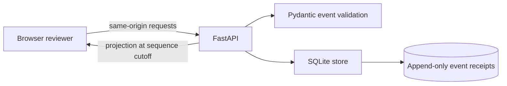

# Architecture

The demo is a small, local application. FastAPI serves both the JSON API and the buildless HTML, CSS, and JavaScript interface. Pydantic validates incoming event payloads; SQLite stores immutable receipts and assigns each a per-stream sequence number.

## Receipt and projection path

Each accepted event is stored with its normalized payload, server receipt time, and sequence. An exact retry returns its original receipt; an event ID reused with different content is rejected. Corrections append a new receipt that points to an earlier original. Existing receipts are not rewritten.

To reconstruct a listing, the service first limits receipts to the requested ingestion sequence, then resolves corrections, then orders effective observations by their observation time and sequence. The resulting state is the latest effective snapshot. This keeps external observation time distinct from local receipt order and makes a past receipt cutoff replayable.

Prices are integer minor units. A missing price remains unknown; it does not become zero. The “last known price” is an asking price from an effective observation, not a confirmed sale price. The service does not infer sales, value, profit, or buying decisions.

## Storage and operating limits

SQLite connections and transactions are scoped to operations. The default database path is `LISTING_LEDGER_DB` or `./var/ledger.sqlite3`. The demo binds to `127.0.0.1` by default and has no authentication. It is for local review, not a hosted multi-user service. Anyone able to edit the SQLite file directly can alter it; the append-only application behavior is not cryptographic tamper protection.

## Code tour

- `listing_ledger/models.py` defines normalized event and projection data.
- `listing_ledger/store.py` persists receipts and derives projections.
- `listing_ledger/api.py` exposes the HTTP contract and serves the interface.
- `listing_ledger/demo.py` creates an isolated synthetic replay.
- `tests/` covers validation, retries, corrections, ordering, cutoffs, and persistence.
